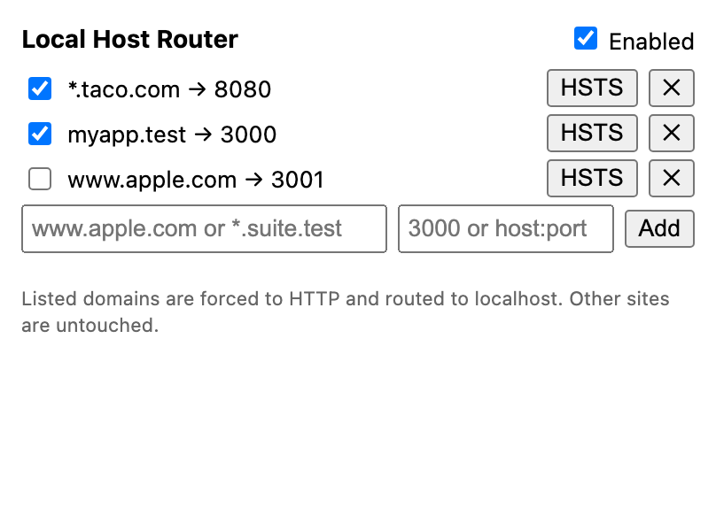

# Local Host Router

Chrome extension that routes chosen domains to local Docker ports, with no hosts file edit and no admin rights.
Type `taco.com` in Chrome and it loads whatever is listening on `localhost:8080`.



## How it works

For each enabled rule the extension does two things:

1. **PAC proxy** (`chrome.proxy`): `http://<domain>` requests go to `PROXY 127.0.0.1:<port>`. Everything else goes DIRECT.
2. **HTTPS to HTTP redirect** (`declarativeNetRequest`): `https://<domain>` is rewritten to `http://<domain>` before connecting.

The server sees the original `Host: <domain>` header. The request line is proxy-style (`GET http://taco.com/ HTTP/1.1`), which nginx, Caddy, Node and most servers accept.

## Install

1. Open `chrome://extensions` and enable Developer mode.
2. Click **Load unpacked** and select the `extension/` folder.
3. Click the toolbar icon, add a rule, and tick **Enabled**.

Rule format: host `www.apple.com` or `*.suite.test` (the wildcard also matches the bare domain), target `3000` or `host:port`.

## Try it

```sh
cd sample && docker compose up -d   # nginx on localhost:8080, echoes the Host header
```

Add `*.taco.com` to `8080`, then open `taco.com`. You should see `Host header: taco.com`.

```sh
node extension/test_pac.js          # PAC and redirect rule tests
```

## Limits

- **HTTP only.** HTTPS is downgraded for listed domains, so the real HTTPS site is unreachable while a rule is on.
- **HSTS.** Domains Chrome has cached HSTS for loop. The **HSTS** button copies the domain and opens `chrome://net-internals/#hsts`; paste it into "Delete domain security policies". Preloaded domains (apple.com, `.dev`, `.app`) can't be cleared.
- **Use `.test` or `.localhost` names** for new projects: they never get HSTS entries.
- **One proxy owner.** Conflicts with other proxy or VPN extensions.
- **Server compatibility.** Dev servers that choke on proxy-style requests (some Vite/webpack setups) need nginx or Caddy in front.

## Layout

```
extension/   manifest.json, background.js, pac.js, popup.html, popup.js, test_pac.js
sample/      docker-compose.yml, nginx.conf, index.html
```
